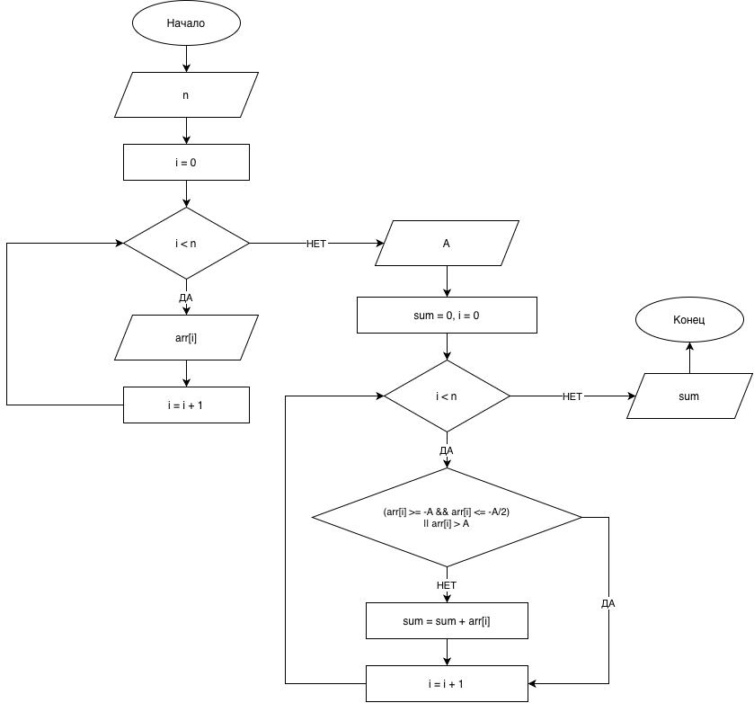

# Домашнее задание к работе 11

## Условие задачи
С одномерным массивом, состоящим из n целых чисел, вводимых с клавиатуры, выполнить вычисление:
**Вариант 29.** Найти сумму элементов массива, находящихся вне диапазонов от -A до -A/2 и больше A.

## 1. Алгоритм и блок-схема

### Алгоритм
1. **Начало**
2. Ввести размер массива `n` с клавиатуры.
3. Ввести элементы массива в цикле.
4. Ввести значение переменной `A` с клавиатуры.
5. Запустить цикл по всем элементам массива для проверки условий:
   - Проверить, попадает ли элемент в запретные диапазоны (от -A до -A/2 или больше A).
   - Если элемент **не попадает** в эти диапазоны, прибавить его к переменной суммы (`sum`).
6. Вывести итоговую сумму на экран.
7. **Конец**

### Блок-схема
 

## 2. Реализация программы

```c
#include <stdio.h>

int main() {
    int n;
    printf("Введите размер массива: ");
    scanf("%d", &n);

    int arr[100];
    printf("Введите элементы массива:\n");
    for (int i = 0; i < n; i++) {
        scanf("%d", &arr[i]);
    }

    int A;
    printf("Введите A: ");
    scanf("%d", &A);

    int sum = 0;

    for (int i = 0; i < n; i++) {
        if (!((arr[i] >= -A && arr[i] <= -A / 2) || (arr[i] > A))) {
            sum += arr[i];
        }
    }

    printf("Сумма = %d\n", sum);

    return 0;
}
```

## 3. Результаты работы программы

```text
Введите размер массива: 5
Введите элементы массива:
-5 2 15 -3 1
Введите A: 10
Сумма = 0
```

## 4. Информация о разработчике

Цимбалист Костя бИЦТ-261
